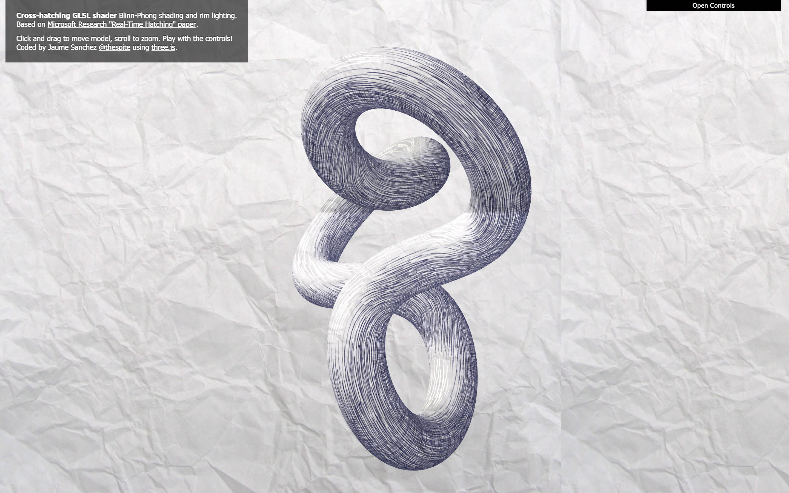

# GLSL Cross-hatching shader

Cross-hatching GLSL shader with Blinn-Phong shading and rim lighting.
Based on Microsoft Research "[Real-Time Hatching](https://hhoppe.com/hatching.pdf)" paper.

#### Demo ####
- **[Cross-hatching](https://spite.github.io/cross-hatching/)**: drag to turn the model, scroll or pinch to zoom, and play with the presets, the shading, the model and the paper

#### 2026 update ####
**Disclaimer:** this demo is from 2012, and was last updated in 2016. three.js still has nothing built in for hatching, so it's still a way to do it. The shading picks two of six textures, from the darkest to the lightest, and blends them. It's simpler than the paper, which blends the textures with weights and keeps the strokes the same width at any distance with mipmaps made for it

The page has been rewritten for current three.js. What changed:

- it runs on three.js r186, from a CDN with an import map, and the controls are [guspira](https://github.com/spite/guspira) instead of dat.gui
- the paper on the model is the same size as the paper behind it on screens with more than one pixel per point. It was half the size on a 2x screen
- the crumpled paper is one sheet that covers the page, it showed seams where it repeated
- zooming has limits. Scrolling far enough turned the picture inside out
- dragging uses pointer events, so it doesn't get stuck when the button is released outside the window, and two fingers zoom
- the camera moves at the same speed at any refresh rate
- a paper that is replaced is released, it used to stay in memory
- it's on GitHub Pages
- the pages that didn't load anymore, the copies of three.js and dat.gui, and the textures that weren't used are gone

#### License ####

MIT licensed

Copyright (C) 2012-2016 Jaume Sanchez Elias, http://www.clicktorelease.com
